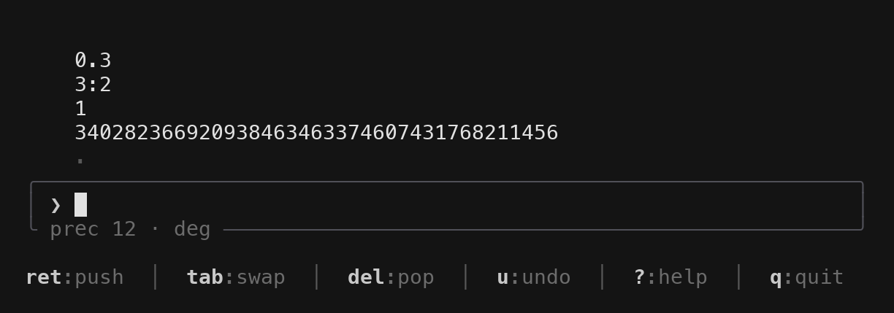

# ecalc

A full-screen RPN calculator for the terminal: a simpler GNU Emacs Calc,
kept to the arithmetic, with unlimited integer precision and variable
floating precision.



## Installation

With a Rust toolchain in place:

```sh
cargo install ecalc
```

## Usage

```sh
ec
```

Quit with `q`. Type the numbers first, then the operation. Space or Enter
pushes.

```
0.1 0.2 +  -> 0.3
3:4 2 *    -> 3:2
90 S       -> 1
2 128 ^    -> 340282366920938463463374607431768211456
```

Press `?` for the keys. Press `?` again for a page on each one, and type
to search (`isqrt` finds `f Q`).

### Shell

`-e` (`--eval`) runs one calculation and prints the top of the stack. It
reads the same keys as the screen. Whitespace separates words.

```sh
$ ec -e '2 128 ^ d g'
340,282,366,920,938,463,463,374,607,431,768,211,456
$ ec -e '30 p 45 S'
0.707106781186547524400844362105
$ ec -e '30 p m r P 4 / S'
0.707106781186547524400844362105
```

`d g` groups digits. `30 p` sets the precision, `m r` switches to radians,
and `P` pushes pi, so the last two lines are the sine of 45 degrees and
the sine of pi/4. `ec --version` prints the version. A failed calculation
prints the message on stderr and exits 1.

## Supported operations

- Exact integers and fractions (`2^100`, `3:4`), decimal floats, and
  rectangular complex numbers `(re, im)`. `0.1 + 0.2` is `0.3`.
- Precision in significant digits, 12 by default.
- Powers, roots, floor, integer division, and remainder. `12 \ 12:7` is `7`.
- Sine, cosine, and tangent, with inverses and hyperbolic forms. Angles
  start in degrees.
- Logarithms, exponentials, factorial, combinations, permutations, and
  Stirling numbers of the first and second kind.
- Gcd, lcm, the extended gcd, a modular inverse, and a prime test.
- Stored variables, and the HP 35s physics constants, plus Earth, the Moon,
  the Sun, and the astronomical unit.
- Display and entry in any radix from 2 to 36.

`cargo test` checks the arithmetic and the screen without opening a terminal.

## License

Apache License 2.0. See [LICENSE](LICENSE).
