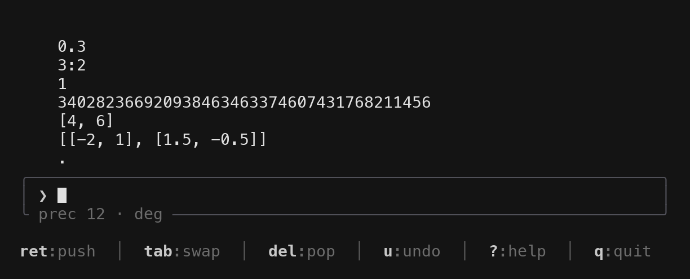

# ecalc

A full-screen RPN calculator for the terminal: a simpler GNU Emacs Calc,
kept to the arithmetic, with unlimited integer precision and variable
floating precision.



## Installation

With a Rust toolchain in place:

```sh
cargo install ecalc
```

## Usage

```sh
ec
```

Quit with `q`. Type the numbers first, then the operation. Space or Enter
pushes.

```
0.1 0.2 +  -> 0.3
3:4 2 *    -> 3:2
90 S       -> 1
2 128 ^    -> 340282366920938463463374607431768211456
```

Press `?` for the keys. Press `?` again for a page on each one, and type
to search (`isqrt` finds `f Q`).

A value wider than the screen stays on one row, as in Emacs: `$` marks
digits hidden on either side. Left and Right scroll it, and `C-a` and `C-e`
(or Home and End) jump to the start and the end.

### Vectors and matrices

`[` starts a vector and `]` ends it. Commas or spaces separate the
elements, which can be any number, a complex, a modulo form, or another
vector.

```
[1, 2] [3, 4] +       -> [4, 6]
[1, 2, 3] 10 *        -> [10, 20, 30]
[4, 9] Q              -> [2, 3]
3M7 [1 2 3 4 5 6] ^   -> [3 mod 7, 2 mod 7, 6 mod 7, 4 mod 7, 5 mod 7, 1 mod 7]
[2, 4, 7] k p         -> [1, 0, 1]
[6, 8, 15] k f        -> [[2, 3], [2, 2, 2], [3, 5]]
```

Keys follow Calc where Calc gives a result, and go element by element where
Calc leaves the vector alone. So `*` of two vectors is the dot product
(`[1, 2] [3, 4] *` is `11`), `[1, 2, 3] 2 ^` is `14`, the vector dotted with
itself, and `A` is the length (`[3, 4] A` is `5`).

Two one-shot prefixes change the next key:

- `V M` maps it over the elements, even where the vector has its own
  meaning: `[1, 2] [3, 4] V M *` is `[3, 8]`, and `[1, 2, 3] 2 V M ^` is
  `[1, 4, 9]`.
- `V R` folds it over the vector on top: `[1, 2, 3, 4] V R +` is `10`, and
  `2023 k f V R *` multiplies the factors back to `2023`.

`v p` packs values from the stack into a vector (`1 2 3 3 v p` is
`[1, 2, 3]`), `v u` unpacks one, `v x` builds `[1, 2, ..., n]`, and `v l`
is the length.

A vector of rows of one length is a matrix, and `* / ^ &` take it whole, as
in Calc:

```
[[1, 2], [3, 4]] [[5, 6], [7, 8]] *   -> [[19, 22], [43, 50]]
[[1, 2], [3, 4]] [5, 6] *             -> [17, 39]
[[1, 2], [3, 4]] &                    -> [[-2, 1], [1.5, -0.5]]
[5, 6] [[1, 2], [3, 4]] /             -> [-4, 4.5]
[[1, 2], [3, 4]] 10 ^                 -> [[4783807, 6972050], [10458075, 15241882]]
[[1, 2], [3, 4]] V D                  -> -2
[[2M7, 3M7], [1M7, 4M7]] &            -> [[5 mod 7, 5 mod 7], [4 mod 7, 6 mod 7]]
```

`b A /` solves `A x = b`. `V D` is the determinant, `V T` the trace, `v t`
the transpose, `V J` the conjugate transpose, `v i` the identity matrix
(`3 v i`), and `V C` the cross product of two 3-vectors. `V M` still maps:
`[[1, 2], [3, 4]] 2 V M ^` is `[[1, 4], [9, 16]]`.

The determinant, the inverse, and `/` are worked out exactly and rounded
once, floats included, so an ill-conditioned matrix loses no digits and a
matrix is singular only when its determinant is exactly zero. As with `/`,
a result that is not whole is a float unless fraction mode is on: `m f`
first makes the inverse above `[[-2, 1], [3:2, -1:2]]`. These keys take
matrices up to 100 by 100; past what a few seconds can do, the answer is
`overflow`.

### Random numbers

`k r` replaces a limit with a random number below it, as Calc's `random`:

```
6 k r           -> an integer from 0 to 5
2.5 k r         -> a float of [0, 2.5), every digit random
0 k r           -> a normal sample, mean 0 and spread 1
[7, 8, 9] k r   -> one of the elements
```

`k a` draws again from the last limit, and `k h` picks without repeats:
`49 6 k h` is six numbers of 0 to 48 in random order, and `10 10 k h` is a
random order of 0 to 9. The numbers come from a cryptographic generator
seeded by the system, and every integer of a range is exactly as likely.

### Shell

`-e` (`--eval`) runs one calculation and prints the top of the stack. It
reads the same keys as the screen. Whitespace separates words.

```sh
$ ec -e '2 128 ^ d g'
340,282,366,920,938,463,463,374,607,431,768,211,456
$ ec -e '30 p 45 S'
0.707106781186547524400844362105
$ ec -e '30 p m r P 4 / S'
0.707106781186547524400844362105
```

`d g` groups digits. `30 p` sets the precision, `m r` switches to radians,
and `P` pushes pi, so the last two lines are the sine of 45 degrees and
the sine of pi/4. `ec --version` prints the version. A failed calculation
prints the message on stderr and exits 1.

### Examples

A few calculations that put the keys together. Each runs as shown with
`ec -e`, and the tests check every one.

**Solve x² ≡ 3 (mod 11).** Square every residue and look for the 3s:

```sh
$ ec -e '1M11 10 v x * 2 V M ^'
[1 mod 11, 4 mod 11, 9 mod 11, 5 mod 11, 3 mod 11, 3 mod 11, 5 mod 11, 9 mod 11, 4 mod 11, 1 mod 11]
```

`10 v x` is `[1, 2, ..., 10]`, and `1M11 *` makes each element a form
modulo 11. `V M ^` squares them one by one; a plain `^` would take the dot
product. The 3s are fifth and sixth, so x ≡ 5 and x ≡ 6.

The same with plain numbers: square first, then take each square modulo
11, since `%` goes element by element too:

```sh
$ ec -e '10 v x 2 V M ^ 11 %'
[1, 4, 9, 5, 3, 3, 5, 9, 4, 1]
```

**A toy RSA key.** With the primes 61 and 53, n is 3233. The private
exponent is the inverse of 17 modulo the totient, and decrypting undoes
encrypting:

```sh
$ ec -e '3233 k f'
[53, 61]
$ ec -e '3233 k t'
3120
$ ec -e '17 3120 k i'
2753
$ ec -e '65M3233 17 ^'
2790 mod 3233
$ ec -e '2790M3233 2753 ^'
65 mod 3233
```

**Fermat's little theorem.** 101 is prime, so 2^100 is 1 modulo 101:

```sh
$ ec -e '2M101 100 ^'
1 mod 101
```

**Factor a number and multiply it back.** `V R *` folds `*` over the factors:

```sh
$ ec -e '2023 k f'
[7, 17, 17]
$ ec -e '2023 k f V R *'
2023
```

**Quotient and remainder.** `H \` gives both, as `[q, r]`: a million
seconds is 11 days and 49600 seconds, and 49600 seconds is 13 hours and
46 minutes and 40 seconds:

```sh
$ ec -e '1000000 86400 H \'
[11, 49600]
$ ec -e '49600 3600 H \'
[13, 2800]
$ ec -e '2800 60 H \'
[46, 40]
```

**The first ten primes.** `H k n` is the nth prime, and it goes element by
element:

```sh
$ ec -e '10 v x H k n'
[2, 3, 5, 7, 11, 13, 17, 19, 23, 29]
```

**The gaps between primes.** Take the primes one place along, subtract
the primes element by element, and take 1 off to count the numbers
between each pair. A 1 is a pair of twin primes:

```sh
$ ec -e '10 v x 1 + H k n 10 v x H k n - 1 -'
[0, 1, 1, 3, 1, 3, 1, 3, 5, 1]
```

**Sums.** The sum of 1 to 100, and of their squares (`I Q` of a vector is
its dot product with itself):

```sh
$ ec -e '100 v x V R +'
5050
$ ec -e '100 v x I Q'
338350
```

**Counting.** The tickets of a 6-from-49 lottery, and the digits of 100!
(its integer log plus one):

```sh
$ ec -e '49 6 k c'
13983816
$ ec -e '100 ! 10 f I 1 +'
158
```

**Two equations.** x + 2y = 5 and 3x + 4y = 6, as `b A /`, in floats and
then in fractions:

```sh
$ ec -e '[5, 6] [[1, 2], [3, 4]] /'
[-4, 4.5]
$ ec -e 'm f [5, 6] [[1, 2], [3, 4]] /'
[-4, 9:2]
```

**Pairs.** `2 v p` packs two vectors into the rows of a matrix, and `v t`
turns the rows into columns, so each row is a pair:

```sh
$ ec -e '[5, 4, 3, 2, 1] [-1, -2, -3, -4, -5] 2 v p v t'
[[5, -1], [4, -2], [3, -3], [2, -4], [1, -5]]
```

**Digits.** Pi to 50 digits, and (1 + 1/n)^n on its way to e:

```sh
$ ec -e '50 p P'
3.1415926535897932384626433832795028841971693993751
$ ec -e '1.000001 1000000 ^'
2.71828046932
```

**Bases.** Hex in, hex out, and a byte in binary:

```sh
$ ec -e '16#FF 1 + d 6'
16#100
$ ec -e '255 d 2'
2#11111111
```

## Supported operations

- Exact integers and fractions (`2^100`, `3:4`), decimal floats, and
  rectangular complex numbers `(re, im)`. `0.1 + 0.2` is `0.3`.
- Integer modulo forms, as in Calc: `M` while typing an integer starts its
  modulus, so `3M1000 567 ^` is `587 mod 1000`. Arithmetic, powers, and
  inverses stay reduced.
- Vectors, nested up to 100 deep, with element-by-element arithmetic, the dot
  product, map (`V M`), and reduce (`V R`).
- Matrices of integers, fractions, floats, complex numbers, or modulo
  forms: product, inverse, integer powers, linear systems, determinant,
  trace, transpose, and the cross product.
- Precision in significant digits, 12 by default.
- Powers, roots, integer division, and remainder. `12 \ 12:7` is `7`, and
  `H \` gives the quotient and the remainder together: `17 5 H \` is `[3, 2]`.
- Floor `F`, ceiling `I F`, round `R` (a half away from zero, as in Calc: `-2.5 R` is `-3`), and truncate `I R`, exact for every input; `H` gives the result as a float.
- Sine, cosine, and tangent, with inverses and hyperbolic forms. Angles
  start in degrees.
- Logarithms, exponentials, factorial, combinations, permutations, and
  Stirling numbers of the first and second kind.
- Gcd, lcm, the extended gcd (`35 15 k E` is `[5, 1, -2]`, as Calc's
  `egcd`), a modular inverse, a prime test (`1` or `0`,
  as Calc's `prime`), prime factors as a vector (`2023 k f` is
  `[7, 17, 17]`), and Euler's totient. The next and previous prime, and the nth
  prime (`1000000 H k n` is `15485863`).
- Random numbers: integers of a range, floats, normal samples, a random
  element, and picks without repeats.
- Stored variables: `s s` copies the top into a variable and leaves it,
  `s t` moves it there, and `s r` pushes it back. A digit names `q0` to
  `q9` in two keys: `s 0` copies, `t 0` moves, and `r 0` recalls.
- The HP 35s physics constants, plus Earth, the Moon, the Sun, and the
  astronomical unit.
- Display and entry in any radix from 2 to 36, with two's complement for a
  chosen word size and grouped digits.
- Undo and redo of the stack and variables.
- A trail of every number typed and every result, with the command that
  made it. `t y` opens it: type to filter by command or digits, and Enter
  pushes the selected value back onto the stack.

`cargo test` checks the arithmetic and the screen without opening a terminal.

## License

Apache License 2.0. See [LICENSE](LICENSE).
